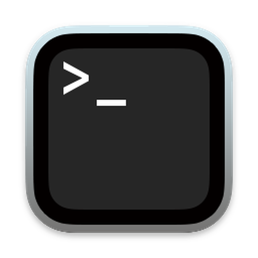

<p align="center">
  
</p>

<h1 align="center">PlumTerm</h1>


A modern, tabbed terminal application with split panes and built-in git status, built with Electron, React and node-pty, by Pluminate. Free to use. The source is public for you to read, under a [source-available licence](#license).

## Features
- **Tabbed Interface:** Multiple terminal sessions in one window.
- **Split Panes:** Vertical and horizontal splits with persistent resizing.
- **Renamable Tabs:** Double-click any tab to give it a custom name.
- **Global Hotkey:** Toggle app visibility from anywhere (default: `Cmd+Shift+T`).
- **Rerun Shortcut:** Quickly rerun the last command with `Cmd+R` (customizable).
- **macOS Optimized:** `Cmd+Q` quits the app, `Cmd+W` closes the window. Closing the last window also quits the app.
- **Git Integration:** Status bar shows current branch, dirty files, and PR info.
- **Change Count:** See the number of changed files at a glance directly in the status bar.
- **Open in GitHub Desktop:** Launch the current repo in GitHub Desktop with one click.
- **Open in IntelliJ:** Open the current project directly in IntelliJ IDEA from the terminal.
- **Open in Finder:** Reveal the current working directory in Finder instantly.
- **AI Commands:** Run AI-powered commands from within the terminal to assist with your workflow.
- **Background Commands:** Run long-running commands in the background and get notified when they finish.

## Installation

Download the latest build from the [Releases](https://github.com/pluminate/plumterm/releases) page.

### Linux

- **Debian / Ubuntu:** download the `.deb` and install it:
  ```bash
  sudo apt install ./plumterm_*.deb
  ```
- **Other distributions:** download the `.AppImage`, make it executable and run it:
  ```bash
  chmod +x PlumTerm-*.AppImage
  ./PlumTerm-*.AppImage
  ```

### macOS

1. Download the latest `.dmg` or `.zip` from the Releases page.
2. Open the downloaded folder or volume.
3. **Double-click `install.sh`** (or run `bash install.sh` in your terminal). It moves the app to `/Applications`, clears the "App is damaged" warning (the app is not code-signed yet) and opens it.

If you prefer to drag and drop the app yourself and see the "App is damaged" error, run:

```bash
xattr -cr /Applications/PlumTerm.app
```

## Development

### Prerequisites
- Node.js (v18+)
- npm

### Setup
```bash
# Install dependencies
npm install

# Start development server (hot reload)
npm start

# Build the frontend
npm run build
```

### Development Commands
- `npm start` - Start dev server with Electron in watch mode
- `npm run dev` - Alternative dev command with concurrent build and server
- `npm run build` - Build frontend assets

## Creating a Release
To create a new versioned release and upload artifacts to GitHub:

```bash
# Auto-increment patch (1.0.x -> 1.0.x+1)
./release.sh patch "Your release notes here"

# Auto-increment minor (1.x.0 -> 1.x+1.0)
./release.sh minor "New feature release"

# Or use a specific version
./release.sh 1.1.0 "Major stable version"
```

This will:
1. Update `package.json` version.
2. Update `CHANGELOG.md`.
3. Create a Git tag and push to GitHub.
4. Trigger GitHub Actions to build and upload the DMG/ZIP.

## License

PlumTerm is **source-available**, not open source.

- **Source code** (this repository): [PolyForm Strict License 1.0.0](LICENSE). You may read the code and use it for noncommercial purposes, but you may not modify it, redistribute it, or use it commercially.
- **Compiled app** (official releases): free to use under the [End-User Terms](EULA.md).

Copyright (c) 2024-2026 Landoulsi Technologies FZE LLC, trading as Pluminate. "PlumTerm" and "Pluminate" are names of the publisher; this license does not grant any right to use them.
